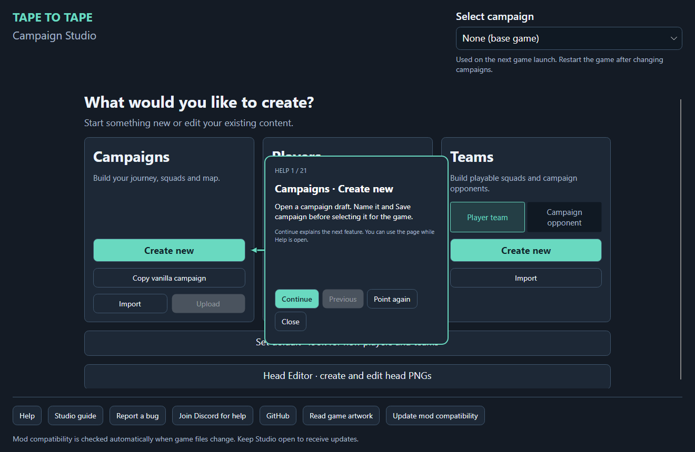
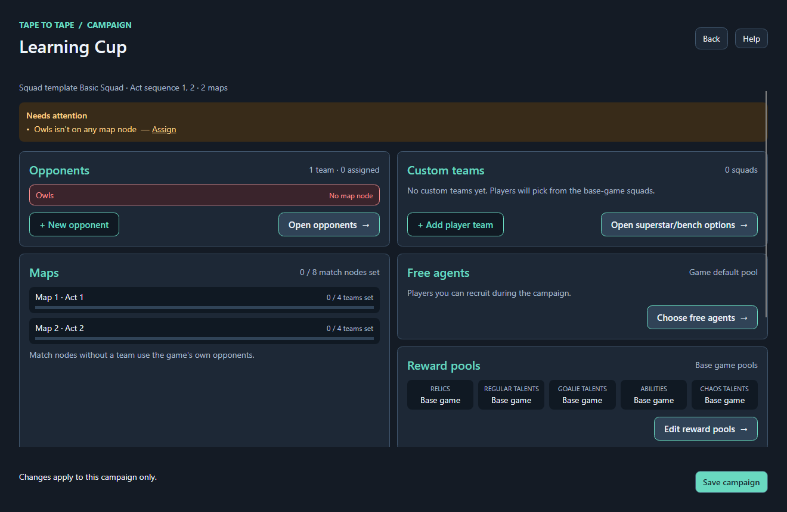
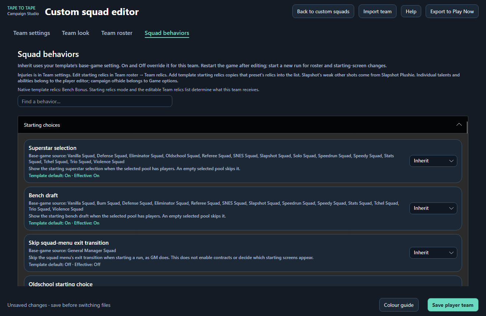
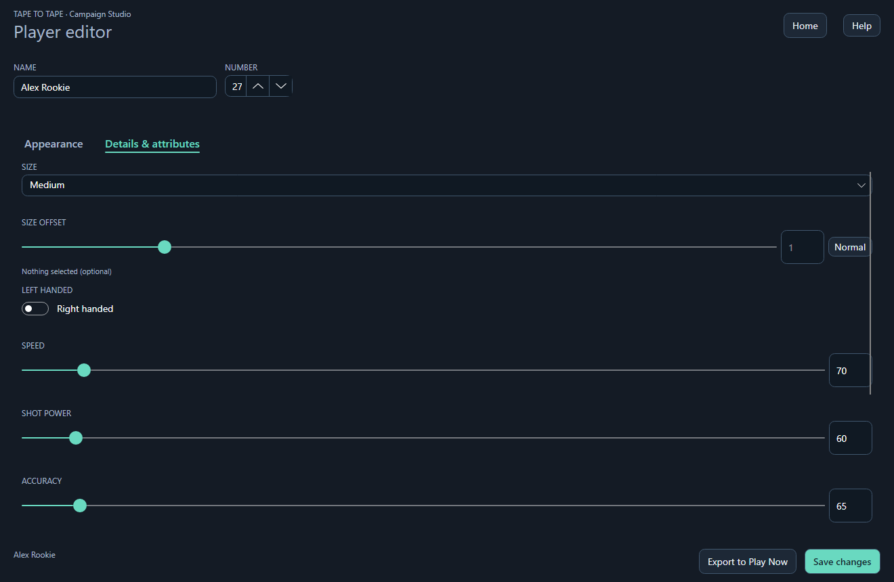
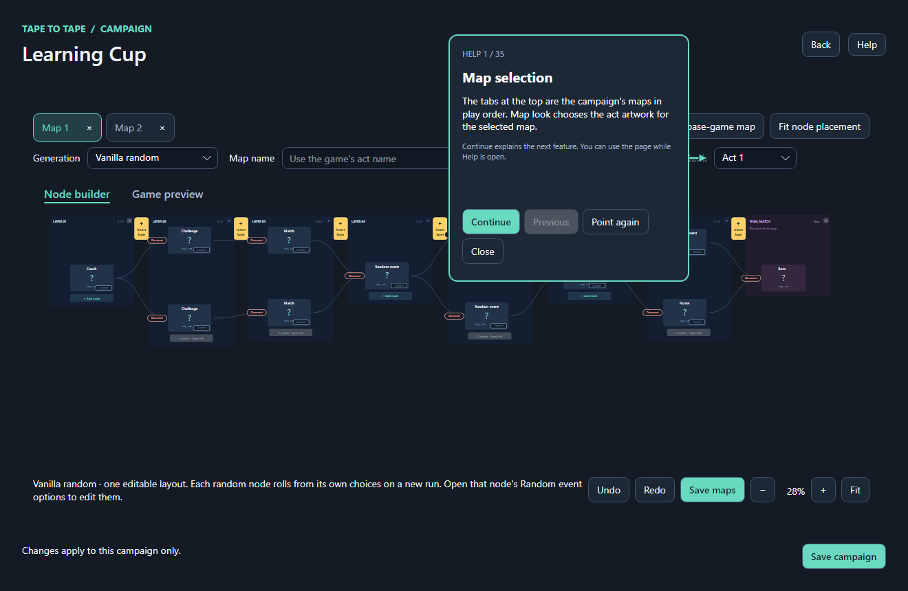
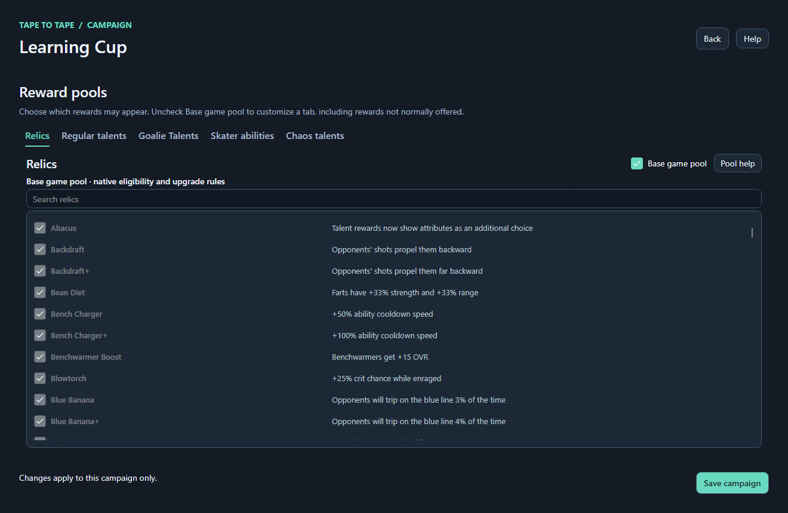

# Tape to Tape · Campaign Studio — Beta 1.0

**Build your own hockey roguelite.** Create campaigns, edit players and teams, design branching maps, choose rewards, and make custom squads for **Tape to Tape**. Campaign Studio is the visual editor; the Custom Campaign Framework mod loads your creations into the game. No coding required.

[Download Beta 1.0 revision 5](https://github.com/Yeastmans/Tape-To-Tape-custom-Campaign-Framework-BepinEX-Mod/releases/tag/beta-1.0-r5-build-1792202217532) · [Install Studio](#install-studio) · [Start here](#start-here) · [Create your first campaign](#create-your-first-campaign) · [Editor guide](#editor-guide) · [Troubleshooting](#troubleshooting) · [Join Discord for help](https://discord.gg/hscxnYghb)

**Beta 1.0 includes Campaign Studio and the in-game mod in one Windows installer.** It targets Steam's **`roguelite` branch, build 25917988**. This is the new Studio release family; older v2.1.x releases contain the previous creator.

**This is a beta test.** Some features may not work as described or may be broken. Studio shows this notice before its main window on every launch. Reporting bugs on [Discord](https://discord.gg/hscxnYghb) or [GitHub](https://github.com/Yeastmans/Tape-To-Tape-custom-Campaign-Framework-BepinEX-Mod/issues) helps immensely.

> [!WARNING]
> **Game updates will likely break this mod.** Compatibility with future Tape to Tape updates is not guaranteed, and you may need to wait for a mod update before it works again. Studio's compatibility checker cannot fix every game change. Check the release notes or [join Discord for updates and help](https://discord.gg/hscxnYghb).

*Screenshots are rendered from the current Studio UI with example content. The teal callouts are Studio's actual Help. Click an image to read it at full size.*

## What you can make

| Make it yours | Tools in Studio |
| --- | --- |
| A complete campaign | Copy a vanilla campaign or start a new one; edit opponents, maps, playable squads, recruitment and rewards. |
| A custom route | Build connected layers and branches; choose encounters, opponents, random events, map artwork and opening titles. |
| Your own squad | Choose a squad preset, build its roster, and override individual squad behaviors and starting screens. |
| Players and goalies | Edit names, numbers, attributes, talents, supported abilities, heads and equipment. |
| A team identity | Create home and away looks, logos, number styles, goalie gear and goal celebration audio. |
| Different opponents | Configure formations, special effects, playing surfaces, puck or ball choices, and match rules. |
| Custom rewards | Create regular talents, Chaos talents, goalie talents and relics with compatible triggers, effects and icons, then choose their matching reward pools. Most combinations and effects are untested and may cause unpredictable results. |
| Custom goalie masks | Open **Goalie Mask Editor** on Home, choose a native template or blank layout, edit PNG views and portraits, then add the mask to goalie equipment. |
| Reusable content | Import independent copies, keep a player/team library, share campaign ZIPs, or export supported content to Play Now. |

## Install Studio

### Windows

**You need:** Windows x64, your own Steam copy of Tape to Tape, and access to its **`roguelite` branch**. Beta 1.0 targets **game build 25917988**. The Windows installer includes the editor runtime and the required BepInEx 6 IL2CPP loader; Python and a separate .NET installation are not needed to use it.

1. In Steam, right-click **Tape to Tape → Properties → Betas** and select **`roguelite`**. If it is unavailable, you need branch access before continuing. Let Steam finish updating.
2. Launch the game once, then quit it. Close any old creator or Studio window.
3. Open [GitHub Releases](https://github.com/Yeastmans/Tape-To-Tape-custom-Campaign-Framework-BepinEX-Mod/releases) and download **`T2T_Custom_Campaign_Framework_Setup.exe`** from **Campaign Studio Beta 1.0**. The GitHub “Source code” ZIP is not the installer.
4. Run Setup from the Windows account you use to play and accept its administrator prompt. Choose the **Studio application folder**, then the separate **Tape to Tape game folder** containing `Tape to Tape.exe`. Steam's **Manage → Browse local files** opens the game folder.
5. Finish Setup and open **T2T Campaign Studio** from its Start menu entry or optional desktop shortcut. Read the beta notice and choose **I understand · Open Studio**. Setup installs the editor separately from the game's loader and mod files.
6. On Home, choose **Read game artwork**. If asked, select your game folder. Studio reads previews and base-game catalogs from your installed game; the game does not need to be running.
7. Studio checks GitHub for updates on every startup, after the beta notice. When a newer Studio and mod bundle is available, it asks before downloading and opening Setup. **Check for updates** on Home retries this at any time. Close the game and save your edits before installing. Existing versions without this button need one manual installer update to gain automatic checks.
8. **Update mod compatibility** verifies the installed mod against your game files. If a repair is needed, Studio also checks GitHub for a newer bundle. **Launch Tape to Tape** checks for releases and verifies compatibility before opening the game through Steam. An unavailable network check leaves editing available; it does not mean the release is current.

> [!TIP]
> **Two different folders:** Studio normally lives in `C:\Program Files\T2T Campaign Studio`. Your campaigns and library live in `%LOCALAPPDATA%\T2T Campaign Studio`. The game folder receives BepInEx and the mod, not your working Studio projects.

### Upgrading from the old creator

Back up your authored content before upgrading. Setup migrates campaigns and library content into Studio's AppData folder and keeps existing destination files when names collide. Its cleanup removes retired fields and runtime import directives and clears unsupported choices; review migrated content in Studio afterward.

Once migration and cleanup succeed, Setup removes the old creator/content folders and retires the old uninstaller. **A successful migration does not retain an automatic backup.** Keep your own copy of the old `BepInEx/plugins/Custom Campaigns Mod` folder and any existing Studio content you want to preserve.

### Other platforms

**Beta 1.0 ships a Windows x64 installer only.** Linux, Steam Deck/Proton and macOS installation and game integration are not validated for this release. Older creator packages use a different interface and do not provide the Studio workflow shown here.

## Start here

Pick the result you want from Home:

| I want to… | Start with… |
| --- | --- |
| Learn by changing an existing campaign | **Campaigns → Copy vanilla campaign**. Choose a squad, copy its campaign, give the draft a name, then save. |
| Build a campaign from scratch | **Campaigns → Create new**. |
| Play somebody else's campaign | **Campaigns → Import**. Choose a ZIP or a community entry, then select the installed campaign on Home. |
| Make a skater or goalie | **Players → Skater / Goalie → Create new** or **Import**. |
| Make a playable squad | **Teams → Player team**. Import it into a campaign's **Custom teams** section when ready. |
| Make a team to play against | Open a campaign's **Opponents** section and create or import an opponent. Assign it to a match node. |
| Design custom head artwork | **Head Editor** on Home, after reading game artwork. |
| Design goalie masks | **Goalie Mask Editor** on Home, after reading game artwork. |
| Create talents and relics | **Custom Talents & Relics → Open Creator & library** on Home, or **Rewards → Creator** in a campaign. |

**For a first project, copy a vanilla campaign and change one thing.** This gives you players, opponents, candidate pools and an editable map for each act. You can learn the save-and-play flow before building a whole season.

At any point, **Help** or **F1** explains the current page and points to its controls. **Continue** and **Previous** move between explanations; **Point again** locates the control. Help does not fill in fields or save content for you. **Studio guide** on Home is the searchable reference. Home also has **Join Discord for help** and **GitHub** buttons to open the community invite and project repository in your browser.

## Create your first campaign

1. **Make a starting copy.** On Home, click **Copy vanilla campaign**, choose a squad and click **Copy campaign**. Give the draft a distinct name and click **Save campaign**. Alternatively, use **Create new** for a fresh draft.
2. **Open an opponent.** From the campaign overview, open **Opponents** and pick a team to edit. Change its name or look, then click **Save opponent**. Save the team before opening its roster players; each player has a separate **Save changes** button.
3. **Place the opponent.** Open a map from the overview. Click a Match or Boss node and select its **Team**. Close node settings with **Done**, then click **Save maps**. An ordinary match node with no assigned team uses a base-game opponent.
4. **Check the overview.** Follow **Needs attention** links to fix missing team references or custom opponents that have not been assigned. Click **Save campaign** after your campaign edits.
5. **Select it for the game.** Return Home and choose your saved campaign in **Select campaign**, at the upper right. The selection is saved immediately.
6. **Restart Tape to Tape and choose New Run.** Pick the intended squad and play through your changed encounter. **Continue** resumes an existing run; it is not a way to regenerate an edited map.

> [!TIP]
> **Saving does not select a campaign.** Always check Home's **Select campaign** before launching. To return to the base campaign, choose **None (base game)** and restart the game.

## Editor guide

### Teams and rosters

**Player teams** are squads you can select and play. **Campaign opponents** are teams you face on map nodes. A library team is reusable source content; importing it into a campaign makes an independent copy.

| Tab | What to edit |
| --- | --- |
| **Team settings** | Name, city, abbreviation, description, transition colors, Stat Scale and goal celebration audio. Player teams also have their squad preset, injuries and squad presentation settings. |
| **Team look** | Team logo, skater and goalie equipment, home/away colors and number style. **Fill look** copies another team's equipment and colors into the draft; it keeps the current identity, logo and roster. |
| **Team roster** | Create or import players into positions, choose supported active starters and edit team relics. Save the team before opening players, and save each player's changes in its own editor. |
| **Squad behaviors** | Player-team rules and starting screens. **Inherit** follows the preset; **On** and **Off** override it for this team. |
| **Opponent settings** | Opponent formations, puck/ball, surface and special effects. Conflicting choices are explained in the editor. |

For a campaign with your own squads, open **Custom teams**, add or import a player team, and enable **Use player teams**. **Custom teams only** hides base-game squads. Configure the bench and superstar choices through **Open superstar/bench options**; the team's behavior settings determine whether those starting screens appear.

**Inherit** keeps the selected squad preset's rule; the effective value is shown below the control. **No Effects** does not enable a bench by itself. To allow a bench on that preset, enable **Bench draft**, set a positive bench size and disable two-line mode. Leaving the starting bench selection empty can skip its draft screen while retaining bench capacity for later recruits; explicitly turning Bench draft off removes that capacity.

**Copied native rosters can contain more players than the editable slots.** Studio exposes five skaters, or ten with two lines, plus a goalie. A copied native Golfers team retains all 13 native forwards, including its extra reserves and their native identities and powers, when you edit the exposed slots. A new custom roster does not acquire those reserves or identity-dependent behavior merely by selecting an opponent effect. Explicit team-wide Stat Scale still affects the whole copied roster.

**Look and sound tips**

- Use **Home / Away** to inspect both kits and **Front / Back** to inspect each side. **Colour guide** explains the channels for the selected equipment.
- Team equipment and kit colors have separate rules. **Team equipment** on uses team styles; off permits individual styles. Team kit colors still come from the team. Check the labels beside stick, skate and blocker colors for their source.
- **Set default · look for new players and teams** on Home affects new content. It does not recolor every existing team.
- **Goal celebration → Choose audio file** imports a clip; preview it, adjust volume, then save the team. Clips are limited to 60 seconds and 256 MB.

### Players and goalies

Use **Appearance** for heads and equipment, and **Details & attributes** for stats and talents. Skaters have an ability selector; goalies use their own attributes and talents. Opponent skaters offer the abilities supported by AI opponents.

Each player can use **Inherit team** or an explicit jersey number style. Imported native styles are preserved, and the mod restores supported authored styles after **Continue** without resetting earned stats or talents. Save source changes before starting a run; changing or deleting its source players during the run can prevent old appearance settings from being recovered.

**Home Helmet: Team colors** equips the ordinary native helmet; **Wing** equips native Wing equipment. Both retain the game's loss and restoration rules without adding a talent or stat bonus. An empty native helmet field imports as **None**, which omits an ordinary starting helmet. Talents, rewards and transformations can still supply their own equipment. Away style does not independently equip or replace the physical helmet.

**Goalie Pass Read** preserves native fractions from 0 to 1. A positive value enables quick reading only when the current difficulty allows it; larger positive values do not continuously increase strength.

**Counts as Prince for Crusader brawls** affects that brawl trigger only. On an **Elite** campaign node, your controlled player must bodycheck the CPU opponent's native Prince or marked player **during charged-shot windup**, with that opponent's **Bodycheck brawl** effect enabled. The native two-second delay and offer limits remain. Boss/Challenge nodes, ordinary bodychecks and the Crusader sound effects alone do not satisfy these conditions.

Opponent effects do not equip an ability. Select the supported ability separately; native AI decides when it can use it. Imported unsupported assignments remain visible until you change them, but are not promised to work with opponent AI. Help beside effects explains required node types, targets, talents and native roster identities.

**Import** can copy from base-game content, the game's saved custom content, or campaign/library content. Team imports also offer the **Player team library**. Editing an imported copy does not edit its source.

For custom heads, open **Head Editor**, name a project, and choose a native template or **From scratch**. **Save head and show previews** creates the project. Edit its directional PNGs and portrait, use the native outline guides, refresh edited PNGs, then choose **Add to player head options**. Reopen the player editor to pick the head and restart the game after changing its artwork.

### Maps and encounters

Open a map from the campaign overview. Map tabs are its maps **in play order**. **+ Add map** extends the campaign; **Import base-game map** gives the selected map a starting layout.

| Control | How to use it |
| --- | --- |
| **Node builder** | Add layers and nodes, then **Connect** paths toward the final Boss. Each layer supports up to two nodes; the final layer contains one Boss. |
| **Generation** | **Custom layout** edits a fixed route. **Vanilla random** begins with imported event pools and opponents; each random node has its own choices. Both use an editable layout. |
| **Map name** | Set the title shown on the map's opening wipe. Leave it blank for the game's act name. |
| **Map look** | Choose the act artwork. The opening ACT number follows the map's position in your campaign. |
| **Game preview** | Inspect the estimated in-game arrangement. It does not play or simulate a run. |
| **Fit / zoom** | Change your view of the builder without changing the in-game camera zoom. **Fit node placement** changes node positions in the draft. |
| **Undo / Redo** | Step through draft edits. **Save maps** validates routes and writes the changes. |

Click a node to edit its type and available settings. Match and Boss nodes can select an opponent and world-map stadium artwork. Period count and length overrides apply to timed matches; goal-target rules stay separate. Match rewards, recruitment counts and random-event options depend on the node type.

> [!TIP]
> **Stadium is the world-map icon.** Set the match's arena and behavior through the opponent's settings. Creating an opponent alone does not place it on a map.

Node edits enter the map draft immediately. **Done** closes node settings; **Save maps** or **Save campaign** writes the draft. Random-event weights have their own **Apply / Cancel** controls: positive values are relative weights, and zero excludes a choice. Save and start a new run to generate those events.

### Rewards and recruitment

**Reward pools** has independent categories for relics, regular talents, goalie talents, abilities and Chaos talents. Keep **Base game pool** enabled to use native eligibility. Disable it to choose a custom pool, then save the campaign. Studio checks that custom pools have enough eligible choices for the route and starting rewards.

See the reward-pool editor

**Free agents** chooses recruitable players separately from the starting roster and bench. Its **Free-agent talent pool** is independent of Regular and Chaos rewards. Start with the base game's available outcomes checked, then add or uncheck individual talent levels. Save the campaign to keep these choices.

- **Each checkbox permits that exact level.** Newly generated random extras and upgrade results must be checked. Checked base talents retain native upgrade chances, but cannot upgrade to an unchecked level. Imported recruitment templates with random talent lists follow the same restriction.
- **Fixed authored talents stay on the player.** Unchecking a level does not remove it from a saved player template, an already generated offer or a player already on your roster. The pool governs new random recruitment additions, including General Manager contract candidates.
- **Weights change direct rolls.** A multiplier of **1** keeps the native weight, **2** doubles that weight rather than the final probability, and **0** prevents a direct roll. A checked level with weight zero can still be a native upgrade result; uncheck it to exclude both routes. Native eligibility and the chance of receiving extra talents still apply.

A custom **talent** pool with nothing checked gives no random extras. An empty recruitable **player** selection falls back to native free agents. Those are separate controls. Contract rules use native countdown, expiry and replacement eligibility; starting contracts are established when a new run begins.

## Save, select, export: which one do I need?

| Action | What it does |
| --- | --- |
| **Save changes** in a player editor | Saves that player's authored fields. |
| **Save player team / Save opponent** | Saves team settings, look and team-level roster changes. Players have their own saves. |
| **Save maps** | Validates and saves map drafts, node settings and assignments. |
| **Save campaign** | Saves campaign settings, starting choices, recruitment/reward pools and maps. |
| Home's **Select campaign** | Chooses the campaign used on the next game launch. Restart after changing it. |
| **Export to Play Now** | Writes separate game custom content. Export again after later edits and restart the game to load it. |

Save before leaving a player or team editor: Home/Back can discard unsaved edits. Campaign navigation may instead ask you to save before continuing. Creating/importing content and some artwork tools can write files immediately; closing a page does not undo those actions.

**Studio project saves and the game's run save are separate.** Use **New Run** for changed maps, starting rosters and starting screens. Use **Continue** to resume a run you already started.

### Export to Play Now

1. Launch Tape to Tape at least once so its save folders exist, then close it.
2. Save the source player or team, including edited roster players and team equipment.
3. Click **Export to Play Now** in the player or team editor.
4. Restart the game and select the exported content from its custom-content menus.

Play Now team exports use one player at **LW, C, RW, LD, RD and G**; extra lines are not exported. The mod restores supported settings that the game's native format cannot hold, including each exported player's effective number style, so keep it installed for those extras. Exporting does not assign content to a campaign or save the Studio source for you.

For detailed requirements, see [Maps and editor](release/docs/MAPS_AND_EDITOR.md), [Squads and rewards](release/docs/SQUADS_AND_REWARDS.md), and [Opponents and equipment](release/docs/OPPONENTS_AND_EQUIPMENT.md).

## Share campaigns

Use **Campaigns → Import** on Home for a campaign ZIP or a community download. If a name already exists, **Keep both** gives the import another name; **Replace mine** moves your current copy to `campaign_backups` first.

Use **Campaigns → Upload** to share a saved campaign with its custom logos and referenced custom head projects in the public community folder. Large campaigns upload in small chunks with progress shown, up to 512 MB. Review and save it first: uploads are public and cannot be removed from inside Studio. This is separate from exporting a team to Play Now.

Downloaded heads are added to your head library. Identical heads are reused; a different head with the same name is imported under a new name and the campaign's references are updated. Existing head artwork is preserved. Restart the game after importing new heads.

## Content locations and backups

| Windows location | Contents |
| --- | --- |
| `%LOCALAPPDATA%\T2T Campaign Studio\campaigns` | Your authored campaigns. |
| `%LOCALAPPDATA%\T2T Campaign Studio\library` | Reusable Studio content. |
| `%LOCALAPPDATA%\T2T Campaign Studio` | Also contains drafts, settings, supporting content and generated game catalogs. Back up the whole folder to preserve the workspace together. |
| `<Tape to Tape>\BepInEx\plugins` | The mod DLL and supporting runtime assets. |
| `<Tape to Tape>\BepInEx\LogOutput.log` | Loader/mod diagnostics from the game. |
| `%USERPROFILE%\AppData\LocalLow\Excellent Rectangle\Tape to Tape` | The game's native saves and exported custom content. |

The Studio uninstaller retains AppData content and the shared BepInEx runtime. **None (base game)** is the campaign selector's off option; it is not an uninstaller for every mod feature.

## Troubleshooting

**Need help? [Join the Discord](https://discord.gg/hscxnYghb)** for help installing the mod, using Campaign Studio, or troubleshooting your creations.

| Problem | What to check |
| --- | --- |
| The interface does not match this README | Check that you installed the new **Campaign Studio** release. The v2.1.x Python creator is different. |
| `roguelite` is missing in Steam | The branch requires access. Confirm you have it before installing this release; do not substitute the old `experimental` instructions. |
| Pictures or base-game import lists are missing | Use **Read game artwork**, select the correct game installation and let the read finish. Repeat after a game update if prompted. |
| The mod stops working after an update | Close the game and open Studio. It checks GitHub at startup and offers newer Studio/mod installers, including beta releases. Use **Check for updates** to retry. **Update mod compatibility** checks the files already installed; if the latest bundle still reports an unsupported game build, a further mod repair is needed. Check `BepInEx/LogOutput.log` if the loader does not start. |
| My campaign does not appear in game | Save it, select it on Home and restart Tape to Tape. For map or starting-roster changes, choose **New Run**. |
| My custom opponent never appears | Assign it to a Match/Boss node and save. Use **Needs attention → Assign** from the overview. |
| My custom squad is missing | Check **Use player teams**, the campaign's own team list, and the game's Custom Squads page. A library copy alone is not a campaign assignment. |
| The map or campaign will not save | Read the validation message. Repair disconnected routes, missing team references, squad-rule conflicts or undersized reward pools as indicated. |
| A player's gear looks different from my edits | Check **Team equipment**, the team's Home/Away kit, and which controls use team colors. Save both the player and team, then restart the game. |
| My export is missing or outdated | Export again after saving, restart the game, and confirm its save location under the Windows account used to play. |
| I need help with a control | Press **F1**, click **Help**, or search **Studio guide** on Home. |

To report a problem, use **Report a bug** on Home or [GitHub Issues](https://github.com/Yeastmans/Tape-To-Tape-custom-Campaign-Framework-BepinEX-Mod/issues). Include your Studio version, game build/branch, steps to reproduce, expected and actual results, and relevant log lines or screenshots. Review attachments for personal paths before sharing. Studio's **Open on GitHub** prepares the issue; you submit it in your browser.

## Beta scope

The release audit checks the editor's mappings and shared mod paths against the installed game's code and data. It does not establish a live gameplay pass for every native ability, random outcome or combination of rules. Confirm a representative case for each distinct trigger or lifecycle you use; there is no need to repeat every cosmetic choice or talent that shares an unchanged path. Report unexpected behavior with the saved campaign and reproduction steps.

Copied native content preserves prerequisites that a newly authored team may not have. **Inherit** and unchanged base-game settings retain their native behavior; explicit custom settings override the controls they describe. A toggle does not automatically grant the native player's identity, equipment, ability or special reserves. Read its Help before designing a trigger around it.

## For contributors

The main components are `src/CampaignCreator` (the Avalonia editor), `src/CampaignCore` (shared campaign formats and rules), `src/CustomCampaignFramework` (the in-game mod), `src/GameArt` (catalogs and previews) and `src/ModCompatibility` (game-build compatibility checks).

The editor targets .NET 8 and the mod targets .NET 6. A development build also needs the project assets, bundled loader/reference files and generated game interop assemblies; a plain SDK install alone is not sufficient. Use [README_BUILD.md](README_BUILD.md) and `tools/Build-CampaignStudio.ps1` for the portable Windows build. The dependency bootstrap restores pinned BepInEx and FFmpeg files; your own matching game installation supplies the generated interop.

*Tape to Tape is by Excellent Rectangle. This is a community modding project built with BepInEx, HarmonyX and Avalonia. Screenshots demonstrate editor workflows; check saved creations in an actual game run.*
